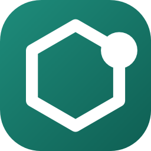
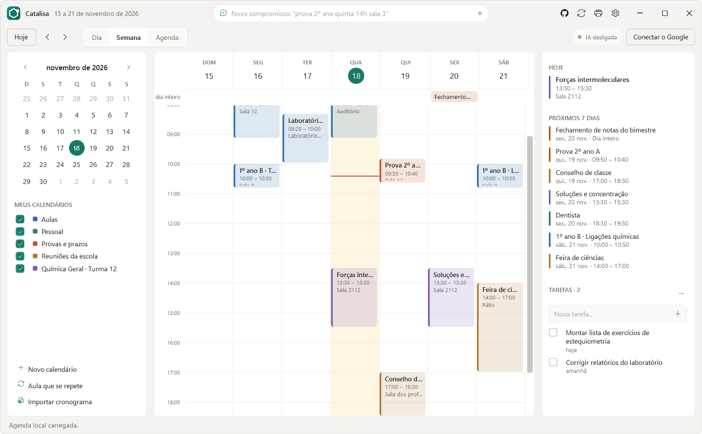
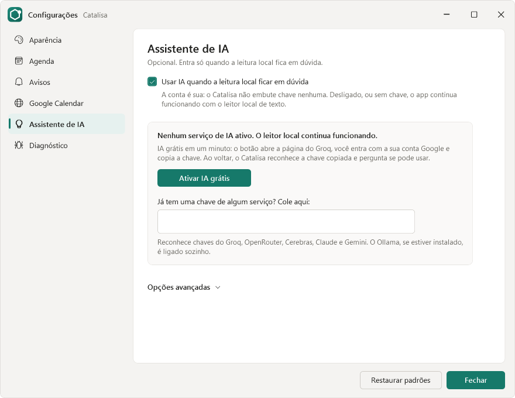
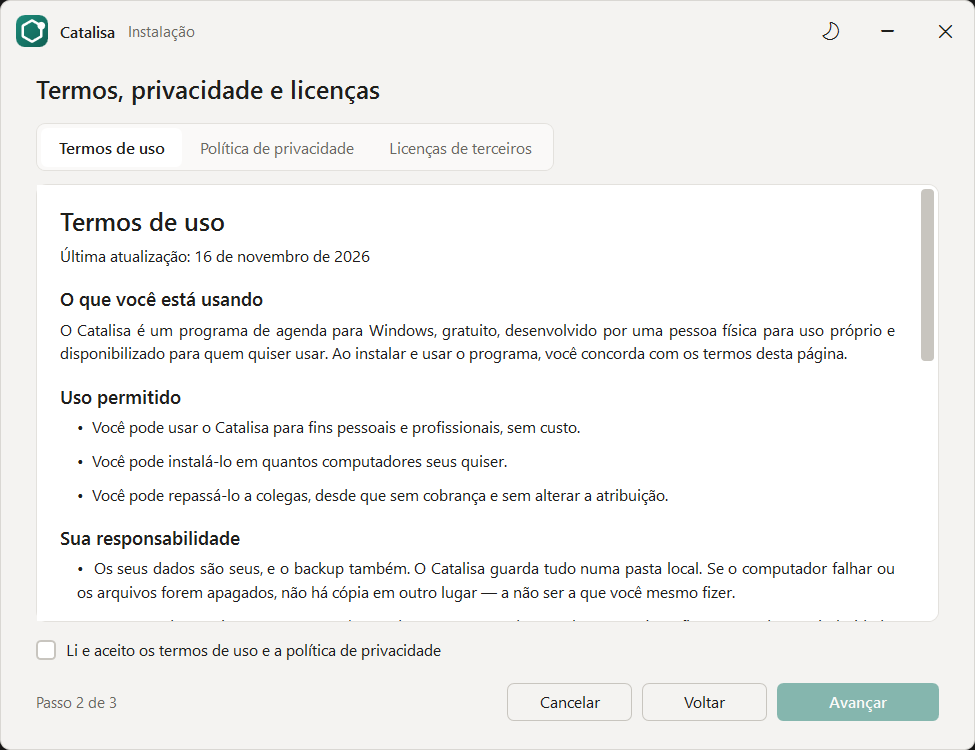

  

<h1 align="center">Catalisa</h1>

  A agenda de desktop para Windows que entende como você escreve. 
  Feita para a rotina de quem dá aula.

  <a href="https://github.com/thgdsrbrANJOS/catalisa-releases/releases/latest"><b>⬇ Baixar a versão mais nova</b></a>
  &nbsp;·&nbsp;
  <a href="https://thgdsrbranjos.github.io/catalisa-releases/">Site</a>
  &nbsp;·&nbsp;
  <a href="https://thgdsrbranjos.github.io/catalisa-releases/privacidade.html">Privacidade</a>
  &nbsp;·&nbsp;
  <a href="https://thgdsrbranjos.github.io/catalisa-releases/termos.html">Termos</a>

<picture>
  <source media="(prefers-color-scheme: dark)" srcset="docs/images/programa-escuro.png">
  
</picture>

## O que ele faz

- **Entende linguagem natural.** Você escreve *“prova do 2º ano quinta 14h sala 3”* e ele entende a data, o horário, a sala e o calendário.
- **Importa o cronograma da escola.** Arraste o PDF ou o Word para a janela e a IA monta os compromissos.
- **Sincroniza com o Google Agenda**, inclusive os cronogramas importados, que passam a aparecer no celular.
- **Avisa com a janela fechada**, pela bandeja e pelas notificações do Windows.
- **Aulas que se repetem, tarefas, impressão da semana** e tema claro e escuro.

## IA grátis em um clique

A IA é opcional. Para ligá-la de graça, o botão **Ativar IA grátis** abre a página do Groq;
você entra com a sua conta Google e copia a chave. O Catalisa reconhece a chave copiada e
**pergunta** se pode usá-la. Também funcionam Claude, Gemini, OpenRouter, Mistral, Cerebras e o
Ollama local, sem chave.

<picture>
  <source media="(prefers-color-scheme: dark)" srcset="docs/images/ia-escuro.png">
  
</picture>

## Instalar

1. Baixe o `Catalisa-<versão>.exe` na [página de versões](https://github.com/thgdsrbrANJOS/catalisa-releases/releases/latest).
2. Abra o arquivo. Se o Windows mostrar *“O Windows protegeu o computador”*, clique em
   **Mais informações → Executar assim mesmo**. O aviso aparece porque o programa é novo e
   não tem certificado pago de editor.
3. Leia e aceite os termos e a política de privacidade, escolha os atalhos e pronto.

Não pede senha de administrador nem instala nada além do Catalisa: o .NET já vem dentro do
arquivo. Para desinstalar, use Configurações do Windows → Aplicativos; a agenda só é apagada
se você marcar essa opção.

<picture>
  <source media="(prefers-color-scheme: dark)" srcset="docs/images/instalador-escuro.png">
  
</picture>

### Atualizações

O Catalisa procura versões novas sozinho, baixa em segundo plano e instala quando você
reinicia ou sai do programa, nunca no meio do uso. Dá para desligar em
Configurações → Diagnóstico.

As versões seguem o formato **1.MM.P**: o número do meio sobe quando chega uma
funcionalidade nova e grande (1.00.0 → 1.01.0); o último sobe em correções, ajustes de
interface e melhorias pequenas (1.00.0 → 1.00.1).

## Requisitos

- Windows 10 ou 11, 64 bits
- Para sincronizar: uma conta Google
- Para a IA (opcional): uma chave grátis do Groq ou de outro serviço suportado, ou o Ollama

## Sobre este repositório

Aqui ficam as versões publicadas do programa e o site (`docs/`, servido pelo GitHub Pages):

- https://thgdsrbranjos.github.io/catalisa-releases/
- https://thgdsrbranjos.github.io/catalisa-releases/privacidade.html
- https://thgdsrbranjos.github.io/catalisa-releases/termos.html

Esses três endereços são os que a tela de consentimento OAuth do Google pede. O código-fonte
fica em um repositório separado.
